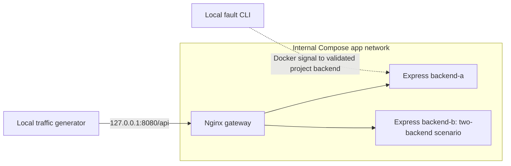

# ResilientCloud

A local failure-detection and recovery research prototype for a Cloud and Network Infrastructures master's scholarship application. Milestone 1 supplies Express backends and Nginx failover; milestone 2 adds an isolated recovery controller, private Docker gate, persisted events, and read-only status. The dashboard remains a later milestone. Docker restart policies remain disabled in every scenario.

Cloud deployment is **deferred until local validation and a zero-cost hosting option are confirmed**, followed by explicit approval to deploy. Two containers on one Mac do not protect against host, Docker VM, power, or host-network failure.

## Prerequisites and local setup

Use Git, a supported Node.js LTS release (Node 24 is used here), npm, Docker, and Docker Compose. On this MacBook Air M2, the existing Node v25.8.2 remains unchanged; Docker Desktop is now reachable and reports `aarch64`. The validated container runs Node v24.22.2. Node and Nginx images are pinned to multi-architecture digests in `Dockerfile` and `compose.yaml`, allowing native ARM64 builds without forcing AMD64 emulation.

Run commands from this directory:

```sh
cd /Users/sajid/Projects/resilientcloud
docker info --format 'Server={{.ServerVersion}} Arch={{.Architecture}}'
docker compose version
npm --userconfig="$PWD/.npmrc" --globalconfig=/dev/null ci
npm run typecheck
npm run build
npm test
```

These install project dependencies only; no system software is installed. npm's cache stays in `.cache/npm`. If the daemon check fails, open the existing Docker Desktop application, wait until its engine is ready, and repeat the check. Do not reset Docker or delete unrelated containers, images, or volumes.

The provided Docker wrappers select the current local Unix-socket endpoint and use a project-local empty auth configuration in `.cache/docker`. They do not use registry credentials or credential helpers. Use the wrapper commands below for builds and experiments.

## Architecture



Only Nginx publishes a host port, bound to loopback. Backends have no published ports and only join the internal `app` network. Nginx also joins an `edge` network so its host port is reachable; using only an internal network prevented host access during the initial validation attempt. In the one/two scenarios, no service mounts Docker's socket. In the recovery scenario, only the isolated gate mounts it; the controller reaches the gate through a private Unix socket. The local fault CLI validates the project name, service name, working-directory label, backend role label, and exact container ID before signalling a backend.

| Endpoint | Healthy response | Injected unhealthy response | Exposed through gateway |
| --- | --- | --- | --- |
| `GET /api` | 200, instance identity and message | 503 | Yes |
| `GET /ready` | 200, `ready: true` | 503, `ready: false` | No |
| `GET /live` | 200, `alive: true` | 200, `alive: true` | No |

The gateway rejects other paths; there are no HTTP fault or restart controls. Instance identity is also returned in `X-Instance-Id`. Only read requests are allowed on the gateway's demo endpoint.

Nginx uses passive failure detection: a failed request can cause an upstream to be avoided temporarily. Configured GET retries cover connection errors, timeouts, and HTTP 502/503/504, with at most two upstream attempts and a two-second retry window. Backend readiness checks are separate from Nginx's passive detection. A single available upstream cannot fail over to another instance.

Dynamic upstream `resolve`, a shared upstream zone, and Docker's embedded resolver (`127.0.0.11`, one-second cache validity) allow Nginx to discover replacement container addresses. See the [Nginx upstream documentation](https://nginx.org/en/docs/http/ngx_http_upstream_module.html), [proxy retry documentation](https://nginx.org/en/docs/http/ngx_http_proxy_module.html), and [Docker Compose networking documentation](https://docs.docker.com/compose/how-tos/networking/).

## Run either scenario

One backend:

```sh
npm run compose -- one config
npm run compose -- one up -d --build
npm run compose -- one ps
curl -i http://127.0.0.1:8080/api
```

Stop the one-backend scenario before switching to two backends. Both manual scenarios intentionally use the same project name and port:

```sh
npm run compose -- one down
npm run compose -- two config
npm run compose -- two up -d --build
npm run compose -- two ps
curl -i http://127.0.0.1:8080/api
```

Allow startup health checks to finish before sending traffic. Use `npm run compose -- two logs --tail 50` to inspect this project's logs. Change `two` to `one` for that scenario. To return from two to one, run `npm run compose -- two down` before starting one. Stop the active scenario with its corresponding `down` command; no general Docker cleanup is needed.

## Inject faults and recover manually

These examples assume the two-backend scenario is running. Each command targets only `backend-a` in this project:

```sh
npm run fault -- crash backend-a
npm run compose -- two ps -a
npm run compose -- two start backend-a
```

`crash` sends SIGKILL to the backend's main process; the container exits, normally with exit code 137. `start` manually starts that stopped container. Wait for it to become healthy before the next experiment.

```sh
npm run fault -- unhealthy backend-a
npm run compose -- two ps -a
npm run compose -- two exec -T backend-a node -e "Promise.all(['/live','/ready','/api'].map(async p=>{const r=await fetch('http://127.0.0.1:3000'+p);return {path:p,status:r.status}})).then(r=>console.log(JSON.stringify(r)))"
npm run compose -- two restart --no-deps backend-a
```

`unhealthy` sends SIGUSR2 with test fault injection enabled. The process remains alive, `/live` stays 200, and `/ready` plus `/api` return 503. Docker subsequently marks it unhealthy. This state persists until a manual restart. A second signal does not clear it. `start` alone does not repair an already running unhealthy process; use the explicit `restart` command above.

**Traffic failover** sends eligible requests to the surviving backend; **container recovery** restores the failed backend. The `one` and `two` scenarios demonstrate failover/manual recovery: failed services remain failed without operator action. The `recovery` scenario below enables controller-directed restarts. Nginx may expose 502/503/504 errors or retry another backend and return 200. Read the recorded upstream attempts to distinguish these cases.

## Automatic recovery (milestone 2)

Stop the active manual scenario before switching to recovery. These commands use only local Docker resources:

```sh
npm run compose -- two down
npm run compose -- recovery up -d --build
curl -s http://127.0.0.1:8080/status
npm run fault -- crash backend-a
curl -s http://127.0.0.1:8080/status
```

Wait for `backend-a` to return to `healthy`, then run `npm run fault -- unhealthy backend-a`. Read `/status` repeatedly or inspect the persisted journals; Docker restart acceptance is not proof of recovery. To keep monitoring but disable recovery:

```sh
RECOVERY_ENABLED=false npm run compose -- recovery up -d
```

Re-enable with `RECOVERY_ENABLED=true npm run compose -- recovery up -d`. This is local configuration, never an HTTP control. `npm run compose -- recovery down` stops the stack while retaining named volumes containing events and recovery budgets.

Live validation reserves loopback ports **18083/18084** and dedicated project names. It refuses existing validation projects/volumes and writes a new evidence directory:

```sh
npm test
npm run typecheck
run_id="$(date -u +%Y%m%dT%H%M%SZ)"
npm run validate:m2 -- --out "results/milestone-2/run-${run_id}"
```

Keep the Mac awake during experiments. The final validated run used `caffeinate -i node tools/validate-m2.mjs --out results/milestone-2/validated`; on a new run choose a new output directory. This prevents idle sleep for that command without changing system settings.

The runner tests both recoverable faults, disabled recovery, a transient failure, persistent failure/exhaustion, budget persistence, sibling availability, container recreation, gate authorization, public-route denial, and status freshness. It saves raw evidence before removing only its own test containers and volumes; export failures preserve the volumes. See [recovery design and timing definitions](docs/RECOVERY.md).

**Milestone 2 validated on 2026-11-03:** all 45 automated tests, TypeScript checks, ARM64 builds, and 16 live integration checks passed. [Final passing report](results/milestone-2/validated/report.json), [unit-test output](results/milestone-2/tests-monotonic.txt), and [attempt index](results/milestone-2/README.md) retain the evidence. Milestone-1 artifacts remain unchanged.

| Fault / mode | Detection delay | Verified recovery delay |
| --- | --- | --- |
| Crash, recovery enabled | 1.275 s | 2.294 s |
| Unhealthy running service, enabled | 1.303 s | 2.294 s |
| Recreated backend, then unhealthy | 0.678 s | 1.666 s |
| Persistent fault, enabled | 1.331 s | Not observed; exhausted after 2 attempts |
| Crash, recovery disabled | 1.319 s | Not observed |
| Unhealthy, recovery disabled | 1.475 s | Not observed |

Delays start at the fault command and use calibrated monotonic clocks; per-fault calibration uncertainty was approximately ±44–47 ms, with additional probe/scheduling effects. Before/after mapping drift stayed below 2.3 ms. Two successful readiness probes establish recovery. The transient fault stayed below the threshold and caused no restart. The exhausted budget survived controller restart. Gate authorization and public-route tests passed; sibling probes remained healthy throughout the fault windows. The recreated-backend timing includes any suspicion accumulated during recreation, so it is not a fresh steady-state fault trial.

The final run recorded **710 actual requests, 708 successful, 2 HTTP 504 failures, zero dropped slots**. The 10-second enabled-recovery crash sample had 98/100 successes; disabled recovery and both unhealthy samples had 100/100. The persistent-failure sample had 200/200 successes through the surviving backend. These windows include pre-fault traffic and do not establish zero downtime or a performance advantage from a single trial. Earlier runner, clock-mismatch, and scheduler-pause failures are preserved and explained in the attempt index. No milestone-2 runtime blocker remains.

## Record traffic

The generator sends fixed-rate GET requests to a loopback URL, limits concurrent requests, and never retries a client request. Use a new filename for every run; existing evidence is never overwritten:

```sh
run_id="$(date -u +%Y%m%dT%H%M%SZ)"
npm run traffic -- --url http://127.0.0.1:8080/api --duration 20 --rate 10 --concurrency 8 --timeout-ms 2500 --label two-manual --out "results/two-manual-${run_id}.jsonl"
```

While that command runs, use a second terminal in this directory to inject a fault. The fault CLI prints a timestamped JSON event. Use the automated validation below when you need fault events and traffic files captured together.

Each JSONL line is one record:

- `start`: configuration, schema version, UTC start timestamp, and zero client retries.
- `request`: actual launch timestamp, monotonic launch/completion times, scheduled slot, final HTTP `status`, `instance`, `success`, terminal `error`, and measured `latencyMs`. `upstreamAddr` and `upstreamStatus` preserve Nginx's response headers; a chain such as `503, 200` reveals an upstream failure hidden by a successful retry. Missing headers are recorded as `null`.
- `skipped`: a scheduled slot not issued because of the concurrency bound or scheduler lag. It is counted as dropped, never silently converted into a request or replayed in a burst.
- `summary`: actual request/success/failure/drop counts, responding-instance counts, success rate, achieved launch rate, and p50/p95 latency.

Success means a complete 2xx response. Success rate uses actual requests as its denominator; dropped slots are reported separately. Achieved rate is requests launched divided by the configured observation duration. Latency runs from request launch through the full response body or terminal error. Percentiles use nearest rank, with separate sets for all requests (including timeouts/errors) and successful requests. Wall duration includes draining outstanding requests. Empty percentile sets are `null`.

## Reproduce milestone validation

This command creates fresh, isolated projects `resilientcloud-m1-one` and `resilientcloud-m1-two`, using loopback ports **18081 and 18082**. Keep both ports free. Choose a new output directory:

```sh
run_id="$(date -u +%Y%m%dT%H%M%SZ)"
npm run validate:m1 -- --out "results/validation-${run_id}"
```

The runner checks configuration boundaries and normal routing; injects both fault types in both scenarios; verifies failure persists with zero automatic restarts; manually starts/restarts the backend; and checks traffic resumes. It also recreates `backend-a`, temporarily occupies its old IP with a labelled test container, and verifies Nginx reaches the new ID/IP without restarting the gateway. That deliberate removal/recreation applies only to the runner's backend. The runner captures logs and removes its own test containers and networks afterward; it refuses to adopt an existing validation project.

The output directory contains `report.json`, `events.jsonl`, per-sample traffic JSONL, and Compose logs. The report records runtime versions, image architectures/digests, source hashes, checks, and measured sample summaries. The first failed host-connectivity run is retained at `results/milestone-1/report.json`. A second failed run at `results/milestone-1/validated/report.json` caught inherited backend labels on the temporary DNS helper; the target checks refused that ambiguous match. The helper now has its own service/role labels, and backend discovery also filters the backend role. The completed run is [results/milestone-1/final/report.json](results/milestone-1/final/report.json).

**Observed results, 2026-11-03:** 18 HTTP/process/tool tests passed; TypeScript check and ARM64 container builds passed; all 16 integration checks passed. The final validation recorded 800 requests across 14 samples, with zero skipped slots. Docker Desktop 29.7.2 and Compose 5.4.0 were used. These are actual observations from the final run:

| Sample | One backend: success / requests | Two backends: success / requests |
| --- | --- | --- |
| Normal (3 seconds) | 30 / 30 | 30 / 30 (15 per instance) |
| Process crash (8 seconds) | 20 / 80 | 80 / 80 |
| Unhealthy but running (8 seconds) | 21 / 80 | 80 / 80 |
| Container recreation (12 seconds) | 108 / 120 | 120 / 120 |
| After changed IP (3 seconds) | 30 / 30 | 30 / 30 |

Traffic was 10 requests/second. Fault/recreation samples include roughly two seconds before injection; counts above cover the entire window. Post-fault assertions exclude requests launched within 100 ms after signal completion to avoid in-flight ambiguity; raw files retain every request. Manual-restart samples also passed, with 30 / 30 requests each in both scenarios. Percentiles and individual request latencies are in the JSONL and report; counts are not derived from expected outcomes.

Crash containers exited with code 137 and stayed stopped. Unhealthy containers stayed running with `/live` 200 and readiness/API 503. Neither recovered automatically: start timestamps stayed unchanged and automatic restart counts stayed zero until manual action. Nginx retried failed upstream requests in the two-backend samples; successful final responses do not imply every upstream attempt succeeded.

Recreation changed backend-a from `172.21.0.2` to `172.21.0.4` in the one-backend test and `172.19.0.2` to `172.19.0.5` in the two-backend test. Container IDs changed, traffic returned to backend-a, and gateway start times stayed unchanged. These addresses are recorded evidence, not configuration to reuse.

No milestone 1 runtime checks remain blocked. These historical results are preserved unchanged. Milestone 2 adds the controller separately; dashboard, CI workflow, repeated trials, and hosting evaluation remain future work. The milestone-1 runner removed its own validation containers/networks; no unrelated Docker cleanup was used.

These short samples are functional smoke checks, not the repeated research experiment matrix. They cannot establish zero downtime, production reliability, or statistically robust performance differences. Later milestones must compare one backend, two backends without automatic recovery, and two with automatic recovery using repeated trials and genuine saved measurements. No automatic-recovery results exist in milestone 1.

## Project files and next milestones

`backend/` contains the service and HTTP/process tests; `Dockerfile`, `compose*.yaml`, and `nginx/` define the runtime; `tools/` contains guarded Docker commands, failure injection, traffic generation, tests, and validation. Build output, dependencies, local caches, and ordinary new results are Git-ignored. The selected milestone evidence is retained for review.

`recovery/`, `compose.recovery.yaml`, and `nginx/recovery.conf` add the controller, private gate, and read-only status service. `compose.persistent-test.yaml` is an opt-in local fault fixture. See [PLAN.md](PLAN.md) for remaining milestones: React/TypeScript dashboard, repeated comparisons, GitHub Actions, and final documentation. No deployment or publishing is part of these local commands.
