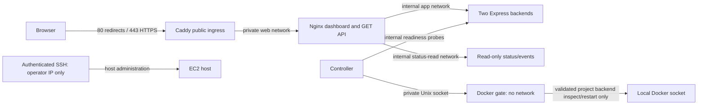

# AWS deployment preparation — Free plan only

**Original preparation runbook (2026-11-04).** Deployment has now been authorized and completed on the user's existing **ap-southeast-2** instance. See [AWS-DEPLOYMENT.md](AWS-DEPLOYMENT.md) for the working URL, actual checks and current hosting policy. **Do not launch another instance or blindly repeat installation/extraction from this historical runbook.** Keep the Free plan. Local Compose and all milestone evidence remain unchanged.

The original plan was us-east-1/t4g.small/48 hours. The user later supplied a running Sydney instance and `resilientcloud.getscoop.app`; its verified deployment supersedes those region/access placeholders. The observed administrator public IP and runtime certificate-contact email are intentionally kept out of repository files.

## Recommendation and measured basis

The original proposal was **one `t4g.small`: 2 ARM64/Graviton2 vCPUs, 2 GiB RAM, 20 GiB encrypted gp3 root disk**, Linux On-Demand/shared tenancy, in **`us-east-1` (N. Virginia)**. The actual existing instance uses the same size in **ap-southeast-2**; its regional price estimate is recorded separately. Use gp3's included 3,000 IOPS/125 MiB/s; no provisioned extras. Building on the Mac M2 and transferring ARM64 images avoids Node/npm/build tools or a registry login on EC2.

The six existing container memory limits total **704 MiB**. The additional HTTPS ingress is capped at 128 MiB, giving **832 MiB** of container limits. These are ceilings, not measured consumption. The short [local ARM64 profile](../results/aws-preparation/profile/report.json) measured all seven containers through HTTPS:

| Sample | Total container memory range | Mean / maximum summed Docker CPU |
| --- | --- | --- |
| Idle, roughly 30 seconds | 234.44–277.31 MiB | 23.70% / 47.11% |
| 10 requests/second, roughly 30 seconds | 239.99–248.60 MiB | 17.52% / 34.04% |

Docker CPU here uses 100% for one fully used vCPU, not CloudWatch's per-instance normalized percentage. The HTTPS workload completed **350/350 requests with zero skips**, including its drain/guard time. Only five samples were collected per phase; Docker sampling/CLI overhead affects the result. These numbers exclude host OS/Docker-daemon memory and are not EC2 benchmarks or established peak requirements. Older milestone evidence contained limits but no resource samples.

`t4g.micro` is eligible too, but its 1 GiB RAM leaves only 192 MiB if all configured containers approach their limits, and its CPU baseline is lower. **Small is the smallest prudent recommendation, not a proven hard minimum.** Two GiB gives room for Ubuntu, Docker, health-check processes, TLS and short spikes. Recheck `free -h`, `docker stats`, CPU-credit balance and readiness after the future EC2 launch before sharing the demo.

Set **CPU credit mode to Standard**, not Unlimited. T4g small earns 24 CPU credits/hour and has a 20%-per-vCPU baseline (0.4 vCPU sustained in aggregate); a CPU credit is a vCPU-minute, distinct from the $100 billing credit. Standard can throttle after bursting credits are exhausted, affecting probe timing, but avoids Unlimited surplus-credit fees. [AWS CPU-credit table](https://docs.aws.amazon.com/AWSEC2/latest/UserGuide/burstable-credits-baseline-concepts.html), [Standard mode](https://docs.aws.amazon.com/AWSEC2/latest/UserGuide/burstable-performance-instances-standard-mode.html).

## Eligibility and credit budget

AWS explicitly lists `t4g.small` and gp3 as eligible under the post-July-2025 credit-based Free Tier. Eligibility does not make all running hours, disk or IPv4 unmetered. The Free plan ends when its time or credits run out; preserve copies before that happens. **Do not upgrade**, activate advanced features, join/create AWS Organizations or set up Control Tower to follow this guide. If any launch choice asks for a Paid plan, stop instead. No Reserved Instances, Savings Plans, paid Marketplace AMIs or new promotional-credit assumptions are part of this proposal. [EC2 eligibility](https://docs.aws.amazon.com/AWSEC2/latest/UserGuide/ec2-free-tier-usage.html), [Free plan restrictions](https://docs.aws.amazon.com/awsaccountbilling/latest/aboutv2/free-tier-plans.html), [current Free Tier FAQ](https://aws.amazon.com/free/free-tier-faqs/).

Official `us-east-1` Linux/shared On-Demand rates retrieved on 2026-11-04:

| Component | Rate | 730-hour planning month |
| --- | --- | --- |
| t4g.small | $0.0168/running hour | $12.264 |
| One auto-assigned public IPv4 | $0.005/assigned hour | $3.650 |
| 20 GiB gp3 | $0.08/GB-month | $1.600 |
| **Total baseline credit use** | About $0.024/hour with disk | **$17.514** |

The [official AWS regional price list](https://pricing.us-east-1.amazonaws.com/offers/v1.0/aws/AmazonEC2/current/us-east-1/index.csv) is saved as selected rows in `results/aws-preparation/selected-prices.json` (Linux/shared/Used/OnDemand, not reserved prices). See [EC2 pricing](https://aws.amazon.com/ec2/pricing/on-demand/), [gp3 pricing](https://aws.amazon.com/ebs/pricing/) and [public IPv4 pricing](https://aws.amazon.com/vpc/pricing/). EBS is charged for provisioned capacity even while the instance is stopped. An Elastic IP is also charged when idle; this plan uses an auto-assigned IP instead.

| Operating schedule | Compute | IPv4 | EBS | Estimated total credits consumed |
| --- | --- | --- | --- | --- |
| 48 running/storage hours | $0.81 | $0.24 | $0.11 | **$1.15** |
| 7 days continuously | $2.82 | $0.84 | $0.37 | **$4.03** |
| 730 hours continuously | $12.26 | $3.65 | $1.60 | **$17.51** |
| All 182 days continuously | $73.38 | $21.84 | $9.57 | **$104.80 — exceeds $100** |
| 8 hours/day over 182 days; disk retained throughout | $24.46 | $7.28 | $9.57 | **$41.31** |

These planning estimates use 730 hours/month for storage; actual monthly proration varies. They assume no other account usage, Standard CPU mode, no Elastic IP, no snapshots/paid DNS/load balancer/NAT/custom metrics, and internet egress within AWS's shared 100 GB/month allowance. Taxes, a domain purchase and excess traffic are not included. [AWS transfer allowance and tax treatment](https://aws.amazon.com/ec2/pricing/on-demand/). The regional list also prices t3.small/x86 at $0.0208/hour, approximately $20.43/month including the same disk/IP; it would require an AMD64 bundle and offers no advantage for this M2-based project.

**Historical preparation recommendation (superseded by continued-hosting authorization): run only during demonstration/testing hours and reserve at least $15 of the balance.** At 8 hours/day the modeled $41.31 leaves about $58.69 before other usage. For current continuous hosting, check Billing → Free Tier/credits each active day and review the remaining runway before the balance or plan expires; the old demonstration-only schedule is not active. Alerts/forecasts are not hard spending caps. Do not depend on spending every last credit or keeping resources accessible after the Free plan ends.

AWS advertises a separate t4g.small 750-hour/month trial through 2026-12-31, but the Free-plan FAQ also restricts additional incentive offers. Its account-specific application has not been verified, and it expires before the full 182-day window. **The budget assumes no trial discount.** Do not upgrade to obtain it. [AWS T4g offer](https://aws.amazon.com/ec2/instance-types/t4/).

Recalculate without contacting an AWS account:

```sh
node tools/aws-cost.mjs
node --test tools/aws-cost.test.mjs
node tools/validate-aws-config.mjs
```

## Architecture and exposure



Only Caddy publishes public TCP 80/443. Nginx's 8080 binding remains host-loopback-only for SSH administration. No backend/status/controller/gate port is published. Caddy has no Docker/gate socket or management API; Nginx still rejects fault/recovery routes and writes. The gate is still the only Docker-socket holder. Docker control remains trusted host administration; no remote Docker TCP listener is enabled.

The gateway also joins the existing non-internal `edge` bridge because Docker suppresses the loopback host-port mapping for a container connected only to internal bridges. This was found during EC2 deployment; port 8080 stays explicitly bound to 127.0.0.1. No backend, status service, controller or Docker gate joins that edge network.

Fault injection defaults **off** in the AWS overlay. An authenticated SSH administrator can explicitly enable the existing signal handler and use project-scoped Compose commands. Nothing enables fault controls over public HTTP. All seven restart policies remain `no`, so backend recovery is attributable to the existing controller. A host reboot needs explicit Compose startup; this is not a host-failure recovery system.

`deploy/aws/compose.aws.yaml` is appended to the four existing Compose files. It adds HTTPS, bounded container logs and deployment defaults; local Compose files are not edited. The packaged `release.yaml` pins every runtime image to its content ID with pulling/building disabled. Caddy's upstream image is version/digest pinned during packaging. This avoids relying on registry digest metadata surviving `docker save`/`load`.

## 1. Prepare a portable release locally

From `resilientcloud`, with Docker and existing project dependencies available:

```sh
# If this is a fresh checkout, install both committed lockfiles first.
npm --userconfig="$PWD/.npmrc" --globalconfig=/dev/null ci
npm --userconfig="$PWD/.npmrc" --globalconfig=/dev/null --prefix dashboard ci
node deploy/aws/package.mjs
```

The script builds the dashboard and ARM64 backend/recovery images, pulls pinned public Nginx/Caddy images using an empty project-local Docker auth config, and creates a new `.cache/aws-bundle-<timestamp>/`. It does not push, use AWS credentials, transfer files or deploy. Each bundle contains `images.tar`, `files.tar.gz`, `release.json`, `SHA256SUMS`, and a staging `files/` directory. No private keys, `.env`, Docker credentials, node_modules, old live volumes or TLS secrets are packaged. The saved experiment summary is included in the dashboard build.

The bundle remains outside Git because it contains image binaries. Keep the source checkpoint and the release/checksum metadata together. The full experiment matrix is not rerun: application/recovery policy code is unchanged; this preparation adds deployment configuration and local HTTPS/resource checks.

## 2. Original launch procedure — do not use for the active existing instance

1. Confirm the account still says **Free plan**, credit/time balances are sufficient, and `us-east-1` is acceptable. In EC2's launch wizard verify `t4g.small` and the selected AMI are marked Free Tier eligible. Actual launch availability/quota has not been checked against this account.
2. Choose **Ubuntu Server 24.04 LTS, ARM64, official Canonical, non-Pro**, shared Linux On-Demand, one t4g.small. Do not select a Marketplace/Windows image. Select/import your existing SSH public key; keep its private key only on your Mac. No EC2 IAM role or AWS access keys are needed by this application.
3. Use a public subnet with an Internet Gateway/default route and **auto-assign public IPv4 enabled**. Prefer an existing default VPC; if absent, a VPC with one public subnet, no private subnets, no NAT gateways and no VPC endpoints suffices. Do not add paid networking resources or activate advanced account features to proceed.
4. Security group inbound: **22/TCP from your current public IPv4 `/32` only**, **80/TCP and 443/TCP from `0.0.0.0/0`** for HTTPS issuance/serving. Leave 3000, 4000, 8080, 2019, 2375 and 2376 closed. Do not enable IPv6 in this plan; add no IPv6 ingress rules. Outbound default access is needed for OS updates, DNS and certificate renewal.
5. Root disk: **20 GiB gp3**, encryption with the AWS-managed EBS key, 3,000 IOPS, 125 MiB/s, **Delete on termination enabled**. No extra volumes, snapshots or customer-managed KMS key.
6. Advanced settings: **CPU credits Standard**, detailed monitoring off, no instance profile, **metadata endpoint disabled** (the app uses no AWS APIs), shutdown behavior Stop. Do not attach an ALB, NAT gateway, RDS, EKS or Auto Scaling group. Add a Name/tag such as `resilientcloud-demo` for later cleanup.
7. Review the launch summary and the account plan. Launch only after deployment authorization. Record the region, instance ID, root-volume ID, security-group ID and public IP. None is known/pre-created by this preparation.

## 3. SSH, transfer and install Docker

These are **future manual commands**, not commands executed during preparation. Substitute your actual values; do not send private-key contents or AWS credentials into chat:

```sh
# On your Mac
EC2_IP=REPLACE_WITH_INSTANCE_PUBLIC_IPV4
SSH_KEY=/absolute/path/to/your-existing-key.pem
BUNDLE=.cache/aws-bundle-REPLACE_WITH_PRINTED_TIMESTAMP
# Verify the first SSH host fingerprint against the EC2 console/system log before accepting it.
ssh -i "$SSH_KEY" ubuntu@"$EC2_IP" 'mkdir -p resilientcloud && chmod 700 resilientcloud'
scp -i "$SSH_KEY" "$BUNDLE/images.tar" "$BUNDLE/files.tar.gz" \
  "$BUNDLE/release.json" "$BUNDLE/SHA256SUMS" ubuntu@"$EC2_IP":resilientcloud/
ssh -i "$SSH_KEY" ubuntu@"$EC2_IP"
```

On the new EC2 host, in the project directory:

```sh
cd ~/resilientcloud
sha256sum -c SHA256SUMS
tar --no-same-owner -xzf files.tar.gz
uname -m                         # Must be aarch64
sudo apt-get update
sudo apt-get install -y ca-certificates curl python3 nano
sudo install -m 0755 -d /etc/apt/keyrings
sudo curl -fsSL https://download.docker.com/linux/ubuntu/gpg -o /etc/apt/keyrings/docker.asc
sudo chmod a+r /etc/apt/keyrings/docker.asc
. /etc/os-release
printf 'Types: deb\nURIs: https://download.docker.com/linux/ubuntu\nSuites: %s\nComponents: stable\nArchitectures: %s\nSigned-By: /etc/apt/keyrings/docker.asc\n' \
  "$VERSION_CODENAME" "$(dpkg --print-architecture)" | sudo tee /etc/apt/sources.list.d/docker.sources >/dev/null
sudo apt-get update
DOCKER_VERSION='5:29.7.2-1~ubuntu.24.04~noble'
apt-cache madison docker-ce       # Confirm this exact version exists first
sudo apt-get install -y "docker-ce=$DOCKER_VERSION" "docker-ce-cli=$DOCKER_VERSION" \
  containerd.io docker-buildx-plugin docker-compose-plugin
sudo systemctl enable --now docker
sudo docker version
sudo docker compose version
```

Docker 29.7.2 matches the validated engine/API 1.53. Compose must be >=2.24.4 (`!override` support). If the pinned engine is unavailable, stop for version review; do not silently install a different API version. These installation commands are derived from [Docker's Ubuntu instructions](https://docs.docker.com/engine/install/ubuntu/) and are not run on the Mac. [Compose merge requirements](https://docs.docker.com/reference/compose-file/merge/). Do not expose Docker over TCP or put AWS credentials on the instance. Using `sudo` avoids adding the login user to Docker's root-equivalent group.

## 4. Load, configure DNS, and start

On EC2:

```sh
mkdir -p .cache/aws-docker
printf '{"auths":{}}\n' > .cache/aws-docker/config.json
sudo docker --config "$PWD/.cache/aws-docker" --host unix:///var/run/docker.sock load --input images.tar
python3 - <<'PY'
import json,os,subprocess
for image in json.load(open('release.json'))['images']:
    found=json.loads(subprocess.check_output(['sudo','docker','--config',os.getcwd()+'/.cache/aws-docker','--host','unix:///var/run/docker.sock','image','inspect',image['id']]))[0]
    assert found['Id']==image['id'] and found['Architecture']=='arm64', image
print('All four image identities and ARM64 architecture verified')
PY
cp deploy/aws/.env.example deploy/aws/.env
chmod 600 deploy/aws/.env
nano deploy/aws/.env
```

Set `DEMO_DOMAIN` to an **existing domain/subdomain you control**, `ACME_EMAIL` to your certificate contact email, and leave `RC_ENABLE_FAULTS=false`. Create an A record with your existing DNS provider pointing the hostname to the instance's public IPv4. Remove any conflicting AAAA record; no Route 53 zone/domain purchase is required. Check from your Mac that DNS resolves to this IP before starting.

```sh
# On EC2
sudo sh deploy/aws/compose.sh config --quiet
sudo sh deploy/aws/compose.sh up -d --no-build --wait --wait-timeout 60
sudo sh deploy/aws/compose.sh ps
sudo sh deploy/aws/compose.sh logs --tail 50 https
```

Caddy obtains/renews a public certificate automatically and redirects HTTP to HTTPS. Ports 80/443 and working public DNS must remain available for issuance/renewal. Only Caddy owns those ports; its admin API and HTTP/3 are disabled. Do not copy the local test CA/private key to EC2 or use `curl -k` to pretend public TLS succeeded. [Caddy HTTPS prerequisites](https://caddyserver.com/docs/quick-starts/https), [automatic certificate renewal](https://caddyserver.com/docs/automatic-https).

If you have no domain, stop before a public demo: domain/DNS ownership is a remaining input. An authenticated SSH tunnel to loopback 8080 is a secure private-preview alternative, but is not public browser-trusted HTTPS. Do not buy a domain or enable a paid service automatically.

## 5. Verify before sharing

On EC2:

```sh
curl --fail --silent http://127.0.0.1:8080/status | python3 -m json.tool
sudo sh deploy/aws/compose.sh exec -T gateway nginx -t
sudo sh deploy/aws/compose.sh ps
free -h
df -h /
sudo sh deploy/aws/compose.sh stats --no-stream
sudo sh deploy/aws/compose.sh config
```

Wait for both backends to show fresh `lastProbe.ok=true`, `state=healthy`, correct instance identities, and recovery enabled. Check all restart policies are `no`, only gate has Docker's socket, status mounts controller data read-only with no gate socket, and only Caddy publishes non-loopback ports. The configuration contains the domain/email but no AWS credentials. Use the EC2 console's basic CPU/CPU-credit graphs to check sustained utilization; the local profile cannot establish remote EBS/fsync performance.

From your Mac, using your real domain:

```sh
DEMO_DOMAIN=demo.REPLACE_WITH_YOUR_DOMAIN
curl --fail --show-error --silent "https://$DEMO_DOMAIN/" -o /dev/null
curl --fail --silent "https://$DEMO_DOMAIN/status" | python3 -m json.tool
curl --fail --silent "https://$DEMO_DOMAIN/events" | python3 -m json.tool
curl --fail --silent "https://$DEMO_DOMAIN/experiments/summary.json" -o /dev/null
curl --silent -o /dev/null -w '%{http_code}\n' -X POST "https://$DEMO_DOMAIN/restart" # 404
curl --silent -o /dev/null -w '%{http_code}\n' -X POST "https://$DEMO_DOMAIN/fault"   # 404
curl --silent -o /dev/null -w '%{http_code}\n' -X POST "https://$DEMO_DOMAIN/status"  # 403
```

Open the dashboard on desktop/mobile, verify current probe timestamps and both identities, then open Saved experiments. Those charts remain the **local** 27-trial evidence; do not describe them as EC2 experiments. Save a separately labelled EC2 verification record if/when deployed. No completed experiment matrix rerun is required for these deployment-only changes.

## Authenticated fault demonstration

Only after SSH login and an explicit decision to demonstrate faults:

```sh
# On EC2; recreates the backends with the signal handler enabled.
sudo RC_ENABLE_FAULTS=true sh deploy/aws/compose.sh up -d --no-build --no-deps backend-a backend-b
# Wait for fresh healthy observations after recreation before injecting a fault.
curl --fail --silent http://127.0.0.1:8080/status | python3 -m json.tool
sudo sh deploy/aws/compose.sh kill --signal SIGKILL backend-a
# Wait for verified readiness/cooldown/healthy before the next fault.
sudo sh deploy/aws/compose.sh kill --signal SIGUSR2 backend-a
# After the demonstration, disable the handler and recreate; verify healthy again.
sudo RC_ENABLE_FAULTS=false sh deploy/aws/compose.sh up -d --no-build --no-deps backend-a backend-b
```

The exact service names scope these administrative signals to this Compose project. SSH access grants powerful host administration; protect the key and keep port 22 restricted. A public browser has no way to execute these commands. A process crash and unhealthy running service remain distinct; successful traffic through the sibling does not establish recovery. Exhausted budgets require offline investigation; do not delete checkpoints to rearm automatically.

## Event retention, shutdown and cleanup

The local sample recorded about **2,333 bytes/second of controller+gate journal growth**, roughly **192 MiB/running day**. Extrapolating unchanged rates to 182 continuously running days would exceed 34 GiB; this is a planning extrapolation, not an observed long-duration result. Container stdout logs are bounded separately to 10 MiB × 3 per service. Those limits do not rotate the persistent journals.

While actively using the instance, archive/rotate journals at least weekly, inspect disk daily, and keep at least 5 GiB free. Before maintenance, ensure no incident is actively recovering. On EC2:

```sh
sudo sh deploy/aws/archive-events.sh
df -h /
```

The script validates project ownership, pauses controller/gate, copies/compresses/checksums their journals and the checkpoint, truncates only the archived live journals, and restarts monitoring. **It never clears `status.json`, restart budgets or exhausted latches.** The dashboard timeline then shows the new active journal; older events are in the archive. If any step fails, investigate before resuming with `sudo sh deploy/aws/compose.sh up -d --no-build gate controller`. Download the printed archive directory with `scp`, verify its `SHA256SUMS` on the Mac (`shasum -a 256 -c SHA256SUMS`), and only then deliberately remove that exact old archive directory on EC2. Do not accumulate unlimited backups on the same 20 GiB disk or use broad Docker/volume cleanup commands.

For a break:

```sh
# On EC2: preserves project volumes/certificates and all restart budgets.
sudo sh deploy/aws/compose.sh down
```

Then **stop the EC2 instance in the AWS console and confirm `Stopped`**. Compose down alone does not stop compute/IPv4 billing. EBS keeps consuming credits. Auto-assigned public IPv4 is released; after the next start, update the DNS A record to the new public IP and run the Compose startup command again. Keep the SSH source `/32` current. [AWS stop/start behavior](https://docs.aws.amazon.com/AWSEC2/latest/UserGuide/Stop_Start.html).

For final cleanup after evidence download: run Compose down, terminate only the recorded demo instance, confirm its delete-on-termination root EBS volume was removed, and delete any retained project-only volumes/snapshots/Elastic IP allocations if you explicitly created them. Remove its DNS record and project security group when no longer referenced. No Elastic IP, snapshot, NAT gateway or load balancer is planned here. Verify the console has no remaining billable demo resources. Never run global Docker prune or remove unrelated AWS resources. Keep source/checkpoints/raw experiments on the Mac before Free-plan credits/time expire.

## Preparation inputs resolved for the active deployment

The user supplied an existing **ap-southeast-2** instance, `resilientcloud.getscoop.app`, a downloaded key, certificate email, console host fingerprint, security-group confirmation and actual launch time. These were used for the authorized deployment described in [AWS-DEPLOYMENT.md](AWS-DEPLOYMENT.md). No preparation input remains a deployment blocker. The administrator source IP and contact email remain outside committed files.

The real launch was 2026-11-04 18:47:43 UTC. The original 48-hour stop plan has been superseded: keep this instance running beyond 6 November, subject to remaining credits and Free-plan expiry. No automatic stopping is configured; see AWS-DEPLOYMENT.md for the current policy. Remaining credit balance and Standard CPU mode are user-confirmed rather than obtained through authenticated AWS APIs. This work used verified SSH administration only and made no AWS account-plan changes.

All containers still share one EC2 host. This remains a service-recovery demonstration, not protection against EC2/OS/disk/AZ failure or a production availability guarantee.
