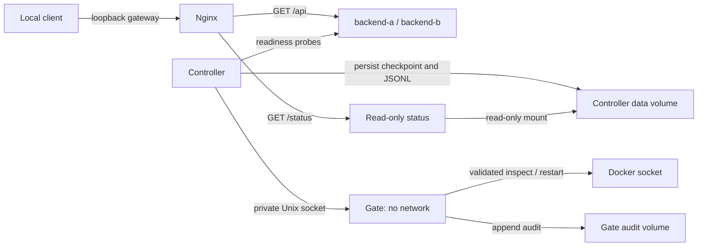

# Milestone 2: isolated automatic recovery

## Boundaries

Only the gate mounts `/var/run/docker.sock`. It has no network or published port. The controller connects through `/run/gate/gate.sock`, mounted read-only; no public service receives that volume. Status has a separate internal network shared only with Nginx and a read-only controller-data mount. It cannot reach the backends, gate, or Docker and exposes no mutation endpoint. The controller listens on no TCP port.

The gate is trusted and has powerful Docker access. A read-only socket *mount* still permits API mutations: authorization comes from the gate code. Host/Docker administrators can bypass these controls and remain trusted. See Docker's [socket guidance](https://docs.docker.com/engine/security/protect-access/) and [API 1.53 reference](https://docs.docker.com/reference/api/engine/version/v1.53/).

## Policy and states

| Setting | Default |
| --- | --- |
| Probe interval | 500 ms per backend; independent loops |
| Full readiness-response deadline | 300 ms; 8 KiB response bound |
| Consecutive failures | 3 before acting |
| Restart budget | 2 attempts per incident, persisted before mutation |
| Verification | 2 consecutive readiness successes within 4 seconds after restart request completes |
| Cooldown | 2 seconds; clearing an incident also requires 2 seconds of continuously healthy observations |
| Gate deadline | 14 seconds; individual Docker calls have 4-second deadlines |
| Docker restart policies | `no` on every service |

Readiness requires HTTP 200, the correct instance identity, and `ready: true`. Probes target the IP returned by fresh gate validation. Recovery verification checks container ID/start time again after a successful response, rejecting observations that cross a process replacement. Verification I/O is capped by the remaining verification budget, and late readiness cannot count as success.

| State | Behavior |
| --- | --- |
| `healthy` | Readiness observed; failure enters suspicion. |
| `suspected_failure` | Count consecutive failures. Success clears suspicion; threshold confirms failure. Disabled recovery continues monitoring without mutation. |
| `recovering` | Persist/charge an attempt, request restart, verify readiness. Docker acceptance alone cannot establish success. |
| `cooldown` | Delay another bounded attempt or require stable readiness before clearing the incident. Flapping preserves the budget. |
| `exhausted` | Budget spent without verified recovery; manual intervention required. Latch survives controller restart and later healthy probes. |

Ambiguous restart timeouts spend an attempt and enter verification. Policy durations use monotonic elapsed time, so UTC synchronization cannot skip cooldown or extend verification. Numeric policy deadlines are anchored to the controller's startup epoch; they are internal clock values, not calendar dates to display. After controller restart, attempts/latches persist and any in-flight verification/cooldown receives a fresh bounded window. Persistence errors stop actions. A missing checkpoint beside an existing journal fails closed rather than resetting budgets. For exhaustion, stop the controller (`npm run compose -- recovery stop controller`), save evidence, investigate and repair the backend. Rearming requires deliberate offline checkpoint maintenance; this milestone has no automatic/public rearm operation. Restarting the controller preserves the latch.

## Gate authorization

The Unix protocol allows only `GET /v1/backends/backend-a` (or `backend-b`) and `POST /v1/backends/backend-a/restart` (or `backend-b`) with JSON containing exactly one full container `id`.

Every operation discovers candidates by fixed project/service labels, requires exactly one, and inspects its full ID. Validation checks project, service, working directory, backend role, instance identity, and application-network membership. Restart must match the freshly validated ID. Missing/ambiguous candidates, old IDs, foreign targets, wrong labels, extra fields, arbitrary paths, and other operations fail closed. Recreation requires a new full validation. Audit persistence precedes mutation; per-service locking prevents overlapping operations.

Internal Docker listing is filtered discovery, never a public listing/proxy API. Exec, create, delete, image, and host operations are unavailable. Privileged administrators able to forge labels are outside this boundary.

## Evidence and timing

The controller atomically checkpoints `/data/status.json` and appends fsynced `/data/controller.events.jsonl`; the gate appends `/audit/gate.events.jsonl`. Named volumes survive backend restart/recreation and ordinary Compose `down`. Status reports snapshot age and per-backend observation age/staleness. Missing/invalid data returns 503; observations become stale after five seconds.

Events contain UTC timestamps; controller events also contain run IDs, process-relative elapsed time, and Linux monotonic timestamps. They distinguish probe failure, threshold confirmation, restart intent, Docker acceptance, verified readiness, cooldown and exhaustion. Docker `RestartCount` is not a counter of controller API restarts: attribution uses gate/controller journals and changed container start times with Docker policies disabled.

- **Detection delay:** fault-command start to threshold-reaching `failure_confirmed`.
- **Recovery delay:** fault-command start to `recovery_verified`, after two validated readiness successes.
- **Verification after confirmation:** monotonic difference between those controller events within one run ID.
- **Not observed:** `null` if no event appears in the observation window; never zero by assumption.

Fault-command completion is separate. Three timed reads before and after each fault map the container's Linux monotonic clock to the runner's `performance.now()` clock; the shortest round trip supplies the offset and an uncertainty of half that trip. The runner rejects mapping changes exceeding both sample uncertainties plus 100 ms. UTC is retained for audit, not duration calculation. Probe cadence, command latency, scheduling, VM suspension and clock drift still limit precision. Keep the machine awake during trials; on macOS use `caffeinate -i npm run validate:m2 -- --out results/milestone-2/new-run` to prevent idle sleep only for that command. Timings describe observed restoration, not the exact instant a fault took effect. Process-relative elapsed origins cannot be compared across controller restarts; Linux monotonic timestamps remain on the same VM clock. Earlier UTC-mismatch and scheduler-pause failures are preserved with diagnoses.

Traffic records include every request outcome and Nginx attempt headers, without client retries. Sibling availability requires successful sibling responses during recovery, successful sibling readiness probes, and unchanged sibling start time. Gateway errors remain in the evidence: passive failover/DNS changes can expose failures while a sibling stays healthy. Recovery does not guarantee zero downtime.

## Validation scope and limits

Tests use SIGKILL (crash), SIGUSR2 (running but unhealthy), brief SIGSTOP/SIGCONT (transient), and the opt-in `START_UNHEALTHY=true` fixture (unhealthy after each restart, accepted only when fault injection is enabled). Public HTTP cannot invoke these faults.

Separate trials disable controller recovery. Security tests use explicitly created local fixtures for foreign IDs, stale IDs and mismatched labels. Test volumes are archived before removal; failed evidence export preserves those volumes and records that fact. Pre-existing test projects/volumes cause refusal. Milestone-1 evidence is retained unchanged.

These are functional smoke trials, not repeated statistical experiments. Controller/gate self-recovery, dashboard, log rotation and remote operator controls are not implemented. Docker VM/host failure defeats the entire prototype. Cloud deployment awaits local validation, a confirmed zero-cost option and explicit approval.
